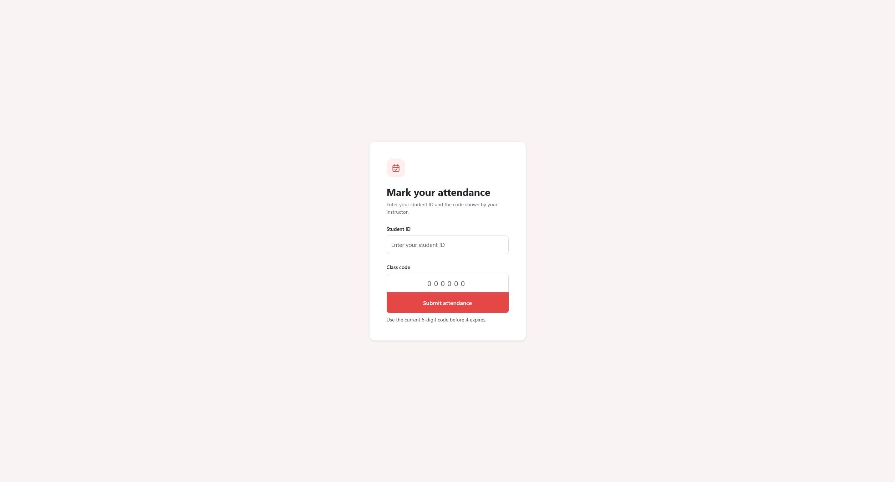
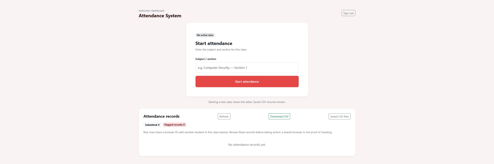

# Attendance System

A web-based student attendance management system built with **Python, Flask, and Bootstrap**, featuring time-based one-time passwords (TOTP), an administrator dashboard, attendance tracking, and CSV exports.

Designed to simplify classroom attendance without requiring students to create individual accounts.

## Overview

The Attendance System allows instructors to manage classroom attendance through temporary verification codes.

Students submit their student ID along with a rotating six-digit code displayed by the instructor. The application validates the submission and records attendance for the active class.

Administrators can manage attendance sessions, monitor submissions, identify potentially suspicious activity, and export attendance records.

## Features

### Student Attendance

- **Student ID verification:** Validates submitted IDs against a predefined student list.
- **Time-based OTP:** Uses rotating six-digit verification codes.
- **Duplicate prevention:** Prevents the same student ID from registering twice during a class session.
- **Instant feedback:** Displays success or error messages after submission.
- **No student accounts required:** Students only need their registered ID and the current verification code.

### Administrator Dashboard

- Password-protected administrator interface.
- Start and close attendance sessions.
- Generate and display rotating OTP codes.
- View attendance records for the current session.
- Identify potentially suspicious attendance submissions.
- Remove individual attendance records.
- Download current and previous attendance reports.

### Attendance Monitoring

The application assigns a randomly generated browser identifier to each session.

When multiple student IDs submit attendance using the same browser identifier, the administrator dashboard flags those records for review.

**Note:** Browser identifiers are only indicators of potentially suspicious activity. They do not reliably establish a student's physical location or identity.

### CSV Export

Each attendance session generates a separate CSV file containing:

| Field | Description |
|---|---|
| `subject` | Class or subject name |
| `student_id` | Student identification number |
| `name` | Registered student name |
| `time_utc` | Submission timestamp in UTC |
| `browser_id` | Browser session identifier |

Previous attendance files remain available for download through the administrator interface.

## Technology Stack

| Technology | Purpose |
|---|---|
| Python | Backend programming |
| Flask | Web application framework |
| Bootstrap | Responsive user interface |
| HTML / CSS | Frontend structure and styling |
| PyOTP | Time-based OTP generation and verification |
| CSV | Student data and attendance storage |
| Jinja2 | Server-side HTML templating |

## Getting Started

### Prerequisites

- Python 3
- pip
- Git

### 1. Clone the Repository

```bash
git clone https://github.com/Fai707/Attendance-System.git
cd Attendance-System
```

### 2. Create a Virtual Environment

```bash
python -m venv .venv
```

Activate it:

**Linux/macOS:**

```bash
source .venv/bin/activate
```

**Windows:**

```powershell
.venv\Scripts\activate
```

### 3. Install Dependencies

```bash
pip install flask pyotp
```

### 4. Prepare Student Data

Create a file named `students2.csv` in the project's root directory.

Example:

```csv
student_id,name
100001,Ahmed
100002,Mohammed
100003,Khalid
```

The application loads this file when starting.

Use fictional student data for testing. Do not commit real student records to a public repository.

### 5. Run the Application

```bash
python app.py
```

Open the application in your browser:

```text
http://127.0.0.1:5002
```

Administrator login:

```text
http://127.0.0.1:5002/admin/login
```

**Important:** The current implementation contains a hardcoded administrator password intended to be replaced before any real deployment.

## How It Works

### Administrator Workflow

1. Log in to the administrator dashboard.
2. Enter a subject name and start an attendance session.
3. Display the generated OTP to students.
4. Monitor incoming attendance submissions.
5. Review flagged records and remove entries if necessary.
6. Close the attendance session.
7. Download the attendance report as a CSV file.

### Student Workflow

1. Open the attendance page.
2. Enter a registered student ID.
3. Enter the current six-digit OTP.
4. Submit attendance.
5. Receive confirmation of the submission.

### OTP Verification

The application uses the Time-based One-Time Password algorithm through the `pyotp` library.

For newly started sessions, the OTP changes every **15 seconds**.

This limits the time during which a displayed verification code can be used.

However, OTP verification alone does not guarantee that a student is physically present in the classroom, since codes can be shared remotely.

## Repository Structure

```text
Attendance-System/
├── app.py
├── templates/
│   ├── index.html
│   ├── admin.html
│   ├── admin_login.html
│   └── attendance_files.html
├── .gitignore
└── README.md
```

The application also expects or creates the following local files:

```text
students2.csv          # Student records
attendance/            # Generated attendance CSV files
```

## Security Considerations

The project includes several security-related mechanisms:

- Time-based verification codes.
- Duplicate student ID submission checks.
- Browser session identifiers for suspicious activity detection.
- CSRF tokens for administrator form submissions.
- HTTP-only session cookies.
- Administrator route protection.
- CSV formula injection mitigation.
- Thread locking around attendance operations.

### Current Limitations

This project is a prototype and is not production-ready.

- Administrator authentication currently uses a hardcoded password.
- Student IDs are identifiers, not proof of student identity.
- OTP codes can be shared with people outside the classroom.
- Browser session identifiers can be reset and do not prevent impersonation.
- Attendance session state is stored in memory and may be lost when the server restarts.
- The current implementation supports one active class at a time.
- CSV storage is not ideal for concurrent, multi-instance deployments.

For real-world deployment, additional authentication, persistent storage, HTTPS, rate limiting, and stronger session management are recommended.

## Future Improvements

Potential improvements include:

- Support for multiple simultaneous classes.
- PostgreSQL database integration.
- Stronger administrator authentication.
- Improved student identity verification.
- Attendance analytics and reporting.
- Role-based access control.
- Better protection against remote attendance submissions.
- Persistent class session management.

## Project Goals

This project was created to explore practical web application development while solving a real classroom management problem.

It provides hands-on experience with:

- Backend development using Flask.
- HTTP requests and form handling.
- Session management and authentication.
- TOTP generation and validation.
- CSV file processing.
- Basic web application security.
- Building administrator dashboards.
- Managing application state.

## Screenshots

### Student Attendance


### Administrator Dashboard


## Author

**Fai707**

GitHub: [github.com/Fai707](https://github.com/Fai707)
